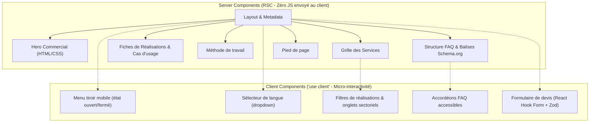
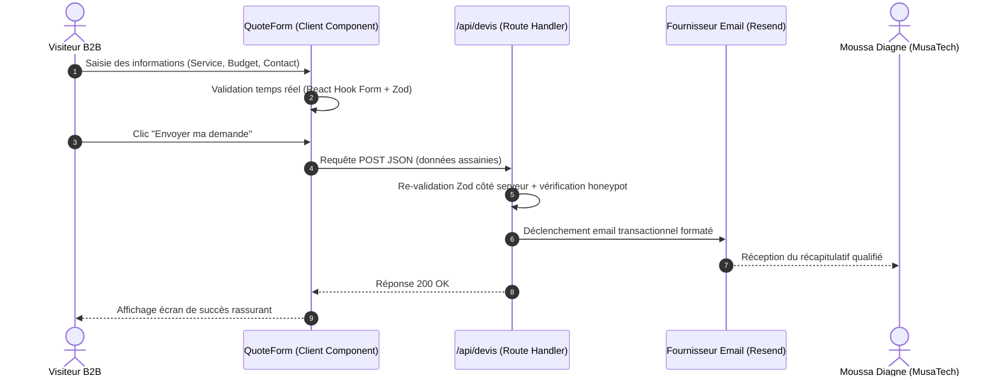

# ARCHITECTURE TECHNIQUE CIBLE — MUSATECH

> **Projet** : MusaTech ([https://www.musatech.tech/](https://www.musatech.tech/))  
> **Auteur / Intervenant** : Senior Software Engineer & Architecte  
> **Documents de référence** : `docs/MUSATECH_MASTER_SPEC.md`, `docs/AUDIT.md`, `docs/REQUIREMENTS.md`  
> **Statut** : Document d'architecture de référence

---

## 1. Principes architecturaux directeurs

1. **Rendu hybride & SEO maximal (Server-First)** :
   - Par défaut, **100% des composants de contenu et de mise en page sont des React Server Components (RSC)**.
   - Les `Client Components` (`"use client"`) sont strictement réservés aux micro-interactions nécessaires : gestionnaire d'état de formulaire, drawer mobile, onglets dynamiques et animations d'entrée.
   - Zéro impact sur le bundle client pour le contenu textuel et le rendu éditorial.
2. **Typage statique strict (TypeScript Strict Mode)** :
   - Aucun type `any`.
   - Modélisation stricte des contrats de données (projets, services, formulaires, locales).
3. **Design System modulaire et typé** :
   - Intégration de **Tailwind CSS** couplée à la palette officielle MusaTech (Navy, Slate, Cyan, Surface).
   - Utilisation des polices Google **Manrope** et **Inter** via le module `next/font` (aucun appel externe bloquant au runtime, zéro CLS).
4. **Validation et assainissement aux frontières** :
   - Schémas **Zod** partagés entre le formulaire client et l'API Route de réception pour un contrôle strict des types et de la sécurité des données.

---

## 2. Structure des dossiers

```text
musatech/
├── .github/
│   └── workflows/
│       └── ci.yml                     # Pipeline CI (Lint, Typecheck, Test, Build)
├── docs/
│   ├── MUSATECH_MASTER_SPEC.md        # Cahier des charges fondateur
│   ├── AUDIT.md                       # Rapport d'audit de l'existant
│   ├── REQUIREMENTS.md                # Spécifications fonctionnelles & business
│   ├── ARCHITECTURE.md                # Le présent document d'architecture
│   └── IMPLEMENTATION_PLAN.md         # Découpage des tâches Git
├── public/
│   ├── images/
│   │   ├── projects/                  # Visuels et captures d'écran des réalisations
│   │   ├── founder/                   # Photo portrait professionnelle de Moussa Diagne
│   │   └── og/                        # Images par défaut pour Open Graph (1200x630)
│   ├── favicon.svg
│   └── site.webmanifest
├── src/
│   ├── app/                           # Architecture App Router (Next.js)
│   │   ├── [locale]/                  # Routage multilingue (/fr, /en)
│   │   │   ├── layout.tsx             # Layout racine (HTML, polices, Header, Footer)
│   │   │   ├── page.tsx               # Homepage commerciale (RSC)
│   │   │   ├── services/
│   │   │   │   ├── page.tsx           # Vue d'ensemble des offres
│   │   │   │   └── [slug]/page.tsx    # Détail d'un service (sites-web, e-commerce, etc.)
│   │   │   ├── solutions/
│   │   │   │   ├── page.tsx           # Vue d'ensemble sectorielle
│   │   │   │   └── [slug]/page.tsx    # Détail sectoriel (immobilier, education, etc.)
│   │   │   ├── realisations/
│   │   │   │   ├── page.tsx           # Galerie complète des réalisations
│   │   │   │   └── [slug]/page.tsx    # Étude de cas détaillée (SSG / generateStaticParams)
│   │   │   ├── a-propos/page.tsx      # Page Fondateur & Vision
│   │   │   ├── contact/page.tsx       # Coordonnées et prise de rendez-vous
│   │   │   ├── devis/page.tsx         # Tunnel de demande de devis
│   │   │   ├── mentions-legales/page.tsx
│   │   │   └── politique-confidentialite/page.tsx
│   │   ├── api/
│   │   │   └── devis/
│   │   │       └── route.ts           # Endpoint API de traitement du devis
│   │   ├── sitemap.ts                 # Générateur automatique de sitemap XML
│   │   ├── robots.ts                  # Directives pour moteurs de recherche
│   │   └── not-found.tsx              # Page 404 corporate sur-mesure
│   ├── components/
│   │   ├── ui/                        # Composants atomiques réutilisables (shadcn/ui style)
│   │   │   ├── button.tsx
│   │   │   ├── card.tsx
│   │   │   ├── badge.tsx
│   │   │   ├── input.tsx
│   │   │   ├── textarea.tsx
│   │   │   └── select.tsx
│   │   ├── layout/                    # Éléments structurants transversaux
│   │   │   ├── header.tsx             # Navigation desktop et mobile
│   │   │   ├── footer.tsx             # Pied de page corporate
│   │   │   ├── mobile-nav.tsx         # Menu tiroir mobile (Client Component)
│   │   │   └── language-switcher.tsx  # Sélecteur de locale (Client Component)
│   │   ├── sections/                  # Blocs de sections éditoriales
│   │   │   ├── hero-commercial.tsx    # Hero B2B avec propositions de valeur
│   │   │   ├── problems-solved.tsx    # Problématiques entreprises résolues
│   │   │   ├── services-grid.tsx      # Grille des 4 offres avec prix d'appel
│   │   │   ├── solutions-tabs.tsx     # Onglets sectoriels interactifs
│   │   │   ├── featured-projects.tsx  # Études de cas phares
│   │   │   ├── work-method.tsx        # Les 4 étapes de travail
│   │   │   ├── founder-section.tsx    # Portrait et réassurance Moussa Diagne
│   │   │   ├── faq-section.tsx        # Questions fréquentes avec accordéons accessibles
│   │   │   └── final-cta.tsx          # Bannière de conversion finale
│   │   └── forms/                     # Formulaires et logique interactive
│   │       ├── quote-form.tsx         # Formulaire de devis multi-étapes (Client)
│   │       └── contact-form.tsx       # Formulaire de contact direct
│   ├── content/                       # Données structurées et référentiels
│   │   ├── services.ts                # Définitions des offres et tarifs d'appel
│   │   ├── solutions.ts               # Données des secteurs d'activité
│   │   ├── projects.ts                # Études de cas détaillées (ex-data.js typé)
│   │   └── faq.ts                     # Questions et réponses
│   ├── lib/                           # Fonctions utilitaires transversales
│   │   ├── utils.ts                   # Helper `cn()` pour Tailwind (clsx + tailwind-merge)
│   │   ├── seo.ts                     # Constructeur de métadonnées Open Graph / JSON-LD
│   │   └── email.ts                   # Client d'envoi d'emails transactionnels (Resend/Brevo)
│   ├── schemas/                       # Schémas de validation Zod
│   │   └── quote-schema.ts            # Schéma de validation de la demande de devis
│   └── types/                         # Définitions TypeScript globales
│       ├── content.ts                 # Types Project, Service, Solution, FAQ
│       └── i18n.ts                    # Types des dictionnaires et des locales
├── messages/                          # Dictionnaires de traduction pour App Router
│   ├── fr.json
│   └── en.json
├── eslint.config.js                   # Configuration ESLint
├── next.config.ts                     # Configuration Next.js (sécurité, images, redirections)
├── tailwind.config.ts                 # Configuration de la charte MusaTech
├── tsconfig.json                      # Typage strict activé
└── package.json
```

---

## 3. Organisation des routes & Routage multilingue

### 3.1. Structure d'URL internationalisée
L'architecture utilise un segment dynamique de premier niveau `[locale]` (`fr` ou `en`).
- Le français (`fr`) est la langue par défaut.
- Exemple d'URL :
  - `https://www.musatech.tech/fr/services/logiciels-metier`
  - `https://www.musatech.tech/en/services/business-software`
- Une redirection automatique est opérée à la racine `/` vers `/${preferredLocale}` en analysant l'en-tête `Accept-Language` du visiteur.

### 3.2. Préservation des liens existants et redirections (301)
Pour garantir la non-régression SEO et préserver les liens pointant vers l'ancien portfolio :
Dans `next.config.ts` :
```typescript
async redirects() {
  return [
    { source: '/work', destination: '/fr/realisations', permanent: true },
    { source: '/expertise', destination: '/fr/services', permanent: true },
    { source: '/contact', destination: '/fr/contact', permanent: true },
  ];
}
```

---

## 4. Stratégie Server Components vs Client Components

Pour garantir une note Lighthouse de 100 en Performance et SEO, nous appliquons une stricte séparation des responsabilités :



---

## 5. Modèles de données (TypeScript Strict)

### 5.1. Modèle d'une Réalisation (Étude de cas B2B)
```typescript
// src/types/content.ts

export type ProjectCategory = 
  | 'mobile' 
  | 'backend' 
  | 'edtech' 
  | 'marketplace' 
  | 'enterprise' 
  | 'healthtech';

export interface ProjectMetric {
  label: string;
  value: string;
}

export interface ProjectCaseStudy {
  id: string;
  slug: string;
  title: string;
  client: string;
  year: string;
  category: ProjectCategory;
  summary: string;
  metrics: ProjectMetric[];
  context: string;
  challenge: string;
  solution: string;
  founderRole: string; // Explicitation transparente du rôle de Moussa Diagne
  stack: string[];
  githubUrl?: string;
  liveUrl?: string;
  thumbnail: string;
  featured: boolean;
}
```

### 5.2. Modèle d'une Offre de Service
```typescript
export interface ServiceTier {
  id: string;
  slug: string;
  title: string;
  tagline: string;
  startingPriceFCFA: number; // Ex. 250 000
  startingPriceDisplay: string; // "À partir de 250 000 FCFA"
  internationalPriceDisplay?: string; // Sur devis / Devis personnalisé
  deliveryTimeEstimate: string; // Ex. "2 à 4 semaines"
  deliverables: string[];
  idealFor: string[];
  caseStudyId?: string;
}
```

### 5.3. Modèle d'une Demande de Devis (Lead B2B)
```typescript
// src/schemas/quote-schema.ts
import { z } from 'zod';

export const quoteSchema = z.object({
  serviceType: z.enum(['website', 'ecommerce', 'software', 'mobile', 'other'], {
    required_error: 'Veuillez sélectionner un type de prestation.',
  }),
  industry: z.string().min(2, 'Veuillez préciser votre secteur d’activité.'),
  budgetRange: z.enum(['under_500k', '500k_1m5', '1m5_3m', 'above_3m', 'custom'], {
    required_error: 'Veuillez indiquer une fourchette budgétaire.',
  }),
  timeline: z.enum(['urgent', '1_month', '3_months', 'flexible']),
  description: z.string().min(20, 'Veuillez décrire brièvement votre besoin (au moins 20 caractères).'),
  fullName: z.string().min(2, 'Votre nom est requis.'),
  company: z.string().optional(),
  email: z.string().email('Adresse email professionnelle invalide.'),
  phone: z.string().min(8, 'Numéro de téléphone ou WhatsApp requis.'),
  honeypot: z.string().max(0, 'Spam détecté.'), // Protection anti-bot
});

export type QuoteFormData = z.infer<typeof quoteSchema>;
```

---

## 6. Gestion du contenu & Internationalisation (i18n)

### 6.1. Contenu structuré
- Les contenus éditoriaux fixes (titres de pages, textes d'accroche, boutons) sont stockés dans les dictionnaires JSON (`messages/fr.json` et `messages/en.json`).
- Les données métier (projets réels, offres, secteurs) sont isolées sous forme de modules TypeScript fortement typés dans `src/content/`. Cela permet :
  - La compilation vérifiée des champs.
  - La génération automatique des routes statiques via `generateStaticParams()`.
  - La mise à jour instantanée sans risque de casser la structure du site.

### 6.2. Stratégie de traduction
- Implémentation via `next-intl` (ou routage natif Next.js léger sans surcharge de runtime).
- Les clés de traduction sont organisées en namespaces clairs :
  - `common` (boutons, labels, statuts)
  - `nav` (liens de navigation)
  - `home` (sections de la homepage)
  - `services` (détail des prestations)
  - `quote` (étapes et erreurs du formulaire)
  - `seo` (titres et méta-descriptions)

---

## 7. Gestion des formulaires & Envoi sécurisé



- **Sécurité** :
  - Rate limiting sur l'endpoint `/api/devis` (max 5 requêtes par IP par tranche de 10 minutes).
  - Validation Zod côté client ET côté serveur.
  - Honeypot invisible pour bloquer les robots de spam sans pénaliser l'ergonomie utilisateur.

---

## 8. Choix des dépendances & Justification

| Dépendance | Utilité | Justification technique |
|---|---|---|
| `next` (v15+) | Framework applicatif | Nécessaire pour le SSR, le SSG, le routage App Router et l'optimisation SEO native. |
| `react` & `react-dom` (v19) | Moteur de composants | Déjà présent dans le dépôt ; maintenu pour le runtime. |
| `typescript` | Sécurité du code | Indispensable pour éliminer les erreurs de typage et documenter les contrats de données. |
| `tailwindcss` | Moteur CSS utilitaire | Permet d'éliminer le fichier CSS géant de 3 100 lignes et de standardiser la charte MusaTech. |
| `lucide-react` | Bibliothèque d'icônes | Déjà présente dans le projet, légère, compatible React 19 et arborescence d'icônes riche. |
| `react-hook-form` | Gestionnaire de formulaire | Performances optimales (renders isolés non bloquants), gestion d'état fluide. |
| `zod` & `@hookform/resolvers` | Validation de schéma | Standard de l'industrie pour valider les formulaires et les API Routes de manière déclarative. |
| `clsx` & `tailwind-merge` | Utilitaires CSS | Permet la fusion conditionnelle propre des classes Tailwind (`cn()`). |

*Dépendances écartées pour éviter la dette technique :*
- Pas de framework CSS tiers lourd (Bootstrap, MUI) : Tailwind CSS suffit amplement.
- Pas d'ORM ou de base de données à ce stade : les contenus sont statiques, les formulaires envoient des emails directs.

---

## 9. Stratégie de tests et qualité continue

1. **Tests unitaires et de schémas (Vitest)** :
   - Validation stricte des schémas Zod (vérification des formats emails, des budgets, des rejets honeypot).
   - Test des fonctions utilitaires (`seo.ts`, formatage des montants FCFA).
2. **Tests de composants et d'intégration (Testing Library)** :
   - Test de rendu du formulaire de devis (affichage des erreurs de validation, désactivation du bouton pendant l'envoi).
   - Test de navigation (ouverture/fermeture du menu mobile, accessibilité des boutons).
3. **Tests de régression de build & Smoke test** :
   - Exécution de `tsc --noEmit` pour garantir zéro erreur de typage.
   - Exécution de `eslint .` pour le respect des bonnes pratiques.
   - Exécution de `next build` pour valider la génération des routes statiques.

