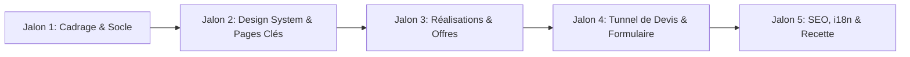

# AUDIT TECHNIQUE COMPLET — PROJET MUSATECH

> **Projet** : MusaTech ([https://www.musatech.tech/](https://www.musatech.tech/))  
> **Fondateur** : Moussa Diagne  
> **Mission** : Audit technique exhaustif du dépôt existant en vue de la transformation en site commercial B2B.  
> **Cadre** : Lecture seule, aucune modification du code applicatif, aucune installation de dépendances, respect strict du document de référence `src/docs/MUSATECH_MASTER_SPEC.md`.

---

## 1. État actuel du dépôt

### 1.1. Framework et versions
- **Core runtime** : React `19.2.5` (`react`, `react-dom`).
- **Outil de build** : Vite `8.0.8` (`@vitejs/plugin-react` `6.0.1`).
- **Type d'application** : Single Page Application (SPA) client-only (`index.html` montant `src/main.jsx` sur `#root`).
- **Typage** : Aucun typage statique. Le projet est intégralement en JavaScript ES2020 (`.jsx`, `.js`). Pas de `tsconfig.json` ni de `jsconfig.json`.
- **Environnement hôte** : Node.js `v22.14.0`, npm `11.16.0`.

### 1.2. Organisation des dossiers
La structure actuelle est plate et axée sur un portfolio personnel mono-page :
```text
scratch/
├── public/
│   ├── favicon.svg              # Utilisé par index.html
│   └── icons.svg                # Inutilisé (sprite orphelin)
├── src/
│   ├── assets/
│   │   ├── hero.png             # 45 Ko, orphelin
│   │   └── vite.svg             # Inutilisé
│   ├── components/              # Dossier plat de 11 composants JSX
│   │   ├── About.jsx            # Grille Bento de présentation
│   │   ├── CareerLogs.jsx       # Terminal simulé interactif
│   │   ├── Contact.jsx          # Section de contact & liens sociaux
│   │   ├── Experience.jsx       # Timeline d'expérience
│   │   ├── Expertise.jsx        # Cartes de compétences & jauges
│   │   ├── Hero.jsx             # En-tête héro personnel
│   │   ├── LanguageSwitcher.jsx # Sélecteur FR/EN
│   │   ├── Marquee.jsx          # Défilement continu de technologies
│   │   ├── Navbar.jsx           # Barre de navigation fixe + drawer mobile
│   │   ├── Reveal.jsx           # Primitives d'animation Framer Motion
│   │   └── Work.jsx             # Liste & accordéon de projets
│   ├── constants/
│   │   └── data.js              # Données statiques brutes (projets, compétences, timeline)
│   ├── docs/
│   │   └── MUSATECH_MASTER_SPEC.md # Cahier des charges MusaTech
│   ├── locales/
│   │   ├── en.json              # Dictionnaire de traduction EN
│   │   └── fr.json              # Dictionnaire de traduction FR
│   ├── test/
│   │   └── setup.js             # Setup Vitest & mocks DOM
│   ├── App.jsx                  # Assemblage linéaire des sections
│   ├── App.test.jsx             # Smoke test d'intégration
│   ├── i18n.js                  # Initialisation i18next & détection navigateur
│   ├── index.css                # Feuille de style monolithique (3 124 lignes)
│   └── main.jsx                 # Point d'entrée React 19
├── eslint.config.js             # Configuration ESLint 9 Flat Config
├── index.html                   # Coquille HTML statique
├── package.json                 # Dépendances et scripts
├── vitest.config.js             # Configuration des tests
└── README.md                    # Documentation du dépôt
```
*Constat* : Absence de structure modulaire (pas de séparation `ui/`, `features/`, `layouts/`, `types/`, `lib/`, ni de Server Components).

### 1.3. Système de routing
- **Routing applicatif** : Inexistant (0 route).
- **Navigation** : Uniquement basée sur des ancres HTML intra-page (`#work`, `#expertise`, `#experience`, `#contact`) gérées avec un défilement doux (`scroll-behavior: smooth`).
- **Limitation majeure** : Impossibilité pour un site commercial B2B de disposer d'URLs dédiées pour les services (`/services/web`, `/services/mobile`), les secteurs (`/secteurs/immobilier`), les études de cas détaillées (`/realisations/assure-express`) ou les pages de conversion (`/devis`).

### 1.4. Composants existants et réutilisables
| Composant | Rôle actuel | Potentiel de réutilisation B2B | Niveau d'effort |
|---|---|---|---|
| `Reveal.jsx` | Wrapper d'animation Framer Motion | Réutilisable pour les entrées de page douces | Faible (ajouter adaptation mobile/motion) |
| `Work.jsx` | Liste de réalisations avec accordéons | Logique d'affichage et données réelles transférables vers une section "Réalisations" | Moyen (refondre en cartes orientées bénéfices clients / ROI) |
| `constants/data.js` | Modèle de données des projets | Contenu très valorisant (Assure Express, Yello, Istamco, Sapiow, eDaktarii) à préserver | Moyen (typer en TypeScript, ajouter métriques B2B) |
| `LanguageSwitcher.jsx` | Bascule FR / EN | Réutilisable pour l'internationalisation | Faible |
| `Marquee.jsx` | Bandeau défilant de technologies | Réutilisable pour afficher des logos clients, partenaires ou stacks | Faible |
| `Navbar.jsx` | Navigation flottante responsive | Structure responsive réutilisable mais liens et statuts à transformer en navigation B2B | Élevé |
| `About.jsx` | Bento grid axée sur la personne | Trop centrée sur le CV personnel ; à adapter pour le volet "Méthode & Fondateur" | Élevé |
| `CareerLogs.jsx` | Terminal développeur | Composant "geek/CV" peu adapté à une cible de directeurs d'entreprises ou de PME | À remplacer par un bloc de réassurance / méthodologie |
| `Contact.jsx` | Copie email + liens directs | Pas de formulaire de qualification B2B | À remplacer par un formulaire complet avec devis |

### 1.5. Librairies UI et styling
- **Styling** : Fichier unique `src/index.css` de **3 124 lignes** (~60 Ko brut).
- **Design tokens actuels** : Thématique "Teranga Modernism / Warm" (`--bg: #faf6f0`, `--ink: #232220`, `--accent: #b8324f` Bissap).
- **Écart avec la spécification MusaTech** : La charte cible est **Corporate Moderne + Tech Premium** avec fond clair et bleu marine contrasté (Navy `#0B1730`, Slate `#172A46`, Cyan `#19B8CD`, Surface `#F4F7FB`, Bordures `#DAE3ED`).
- **Framework CSS utilitaire** : Aucun Tailwind CSS installé actuellement.
- **Bibliothèque de composants** : Aucun composant prêt à l'emploi (pas de shadcn/ui ni Radix Primitives).
- **Icônes** : `lucide-react` `v1.8.0` (compatible avec la charte cible).
- **Animations** : `framer-motion` `v12.38.0`.

### 1.6. Gestion des images et des polices
- **Images** :
  - `src/assets/hero.png` (45 Ko) orphelin.
  - `src/assets/vite.svg` orphelin.
  - `public/icons.svg` orphelin.
  - Aucun format moderne (WebP/AVIF), aucune politique d'optimisation automatique des images responsive (`srcset`, lazy loading natif calibré).
- **Typographies** :
  - Polices chargées via Google Fonts externes bloquantes dans `index.html` : `Fraunces`, `Geist`, `Geist Mono`.
  - **Écart avec la spécification MusaTech** : Le cahier des charges impose formellement **Manrope** pour les titres et **Inter** pour le corps de texte.

### 1.7. SEO actuel et métadonnées
- **Rendu HTML** : SPA 100% côté client. Le fichier initial servi au robot d'indexation est une coquille vide (`<div id="root"></div>`). Les moteurs sans exécution JS complète ou les bots de réseaux sociaux ne voient aucun texte.
- **Balises de base** : Titre et description statiques orientés "profil individuel" dans `index.html`.
- **Open Graph / Twitter Cards** : Totalement absentes (`og:title`, `og:image`, `og:description`, `og:url` inexistantes). Les partages sur LinkedIn, WhatsApp ou Twitter ne génèrent aucun aperçu professionnel.
- **Fichiers de conformité** :
  - Aucun `robots.txt`.
  - Aucun `sitemap.xml`.
  - Aucun balisage sémantique structuré (Schema.org JSON-LD de type `ProfessionalService`, `Organization`, ou `WebSite`).
- **Gestion multilingue** : Gérée côté client par `localStorage` et injection JS. Pas d'URLs localisées (`/fr`, `/en`) ni de balises `<link rel="alternate" hreflang="...">`.

### 1.8. Responsive et accessibilité (a11y)
- **Responsive** :
  - Grille Bento et cartes de projets s'adaptent correctement aux petits écrans.
  - Menu tiroir mobile fonctionnel avec verrouillage du scroll (`overflow: hidden`).
- **Accessibilité** :
  - Améliorations récentes : règles `:focus-visible` et `@media (prefers-reduced-motion: reduce)` en place dans `index.css`.
  - Points faibles :
    - Cartes projets dépliables via un simple `div onClick` (inaccessible au clavier sans `role="button"`, `tabIndex="0"` ni gestionnaire `onKeyDown`).
    - Pas d'attributs ARIA d'état (`aria-expanded`, `aria-controls`) sur les éléments interactifs d'accordéon.
    - Contrastes : certaines teintes de texte secondaire du thème chaud (`#65625e` sur `#faf6f0`) sont en limite de conformité WCAG AA (ratio ~4.3:1).

### 1.9. Performance observable
- **Temps de compilation Vite** : ~720ms - 1.1s (très rapide en dev).
- **Poids des ressources minifiées (Vite build)** :
  - Bundle JavaScript : **465.7 Ko** (146 Ko gzip). Ce poids est excessif pour une page d'atterrissage sans données dynamiques, principalement dû à `framer-motion`, `i18next` avec son détecteur et les deux dictionnaires complets FR/EN embarqués statiquement dans le bundle initial.
  - Feuille de style CSS : **41.3 Ko** (8.3 Ko gzip).
- **Code splitting** : Inexistant (un seul gros chunk JS pour toute l'application).
- **Fonts bloquantes** : Requêtes réseau externes vers Google Fonts retardant le First Contentful Paint (FCP).

### 1.10. Formulaires et fonctionnalités existantes
- **Formulaire de contact / devis** : **Inexistant**. La section contact se résume à :
  - Un bouton de copie de l'adresse email dans le presse-papier.
  - Un lien direct `mailto:`.
  - Un lien direct `tel:`.
  - Des liens externes vers LinkedIn, GitHub et Tàgg Group.
- **Formulaire de qualification commerciale** : Aucun. Aucune capture d'informations clés (type de projet, budget prévisionnel, échéance, secteur, coordonnées professionnelles).
- **Validation** : Ni `react-hook-form` ni `zod` ne sont présents.

### 1.11. Scripts de test, lint, build et déploiement
- **Qualité du code** :
  - `npm run lint` : ESLint 9 configuré avec `eslint-plugin-react`, propre (**0 erreur, 0 avertissement**).
  - `npm test` : Vitest 5 avec JSDOM et Testing Library configuré, test de fumée fonctionnel (**1 test passant**).
  - `npm run build` : Compilation Vite vers `/dist` opérationnelle.
- **Déploiement** : Présence de `@vercel/analytics` dans le code. Déploiement automatisé sur la plateforme Vercel rattaché au domaine `musatech.tech`. Absence de `vercel.json` dédié pour paramétrer les en-têtes de sécurité (CSP, HSTS) ou les redirections.

### 1.12. Risques de migration et liens existants
- **Domaine en production** : `https://www.musatech.tech/` est actif.
- **Ancres existantes** : `#work`, `#expertise`, `#experience`, `#contact`. Tout changement d'architecture doit maintenir des redirections ou des équivalences pour éviter les liens brisés.
- **Données réelles de projets** : Les études de cas actuelles (Assure Express, Yello, Istamco, Sapiow, eDaktarii) comportent des détails précieux (contexte, objectifs, réalisations, technologies) qui constituent la preuve technique indispensable pour le site B2B.

---

## 2. Synthèse et catégorisation

### 2.1. Éléments à conserver
1. **Les données réelles des projets** (`constants/data.js` et clés `projects.bodies` dans `fr.json`/`en.json`) : Projets sérieux, chiffres réels (ex. Yello 200 000 apprenants, Istamco transport international, eDaktarii téléconsultation), rôles précis du fondateur à préserver impérativement.
2. **Le multi-langue FR / EN** : La structure bilingue est déjà prête et validée dans son principe, indispensable pour adresser à la fois le marché sénégalais et le marché international.
3. **Le principe des animations d'entrée discrètes** (`Reveal.jsx`) : À adapter pour respecter strictement la charte tech premium sans alourdir le DOM.
4. **La boîte à outils d'icônes** : `lucide-react` est déjà en place et parfaitement alignée avec la cible.
5. **Le pipeline de tests & linting** : Configuration Vitest + ESLint moderne, garantissant la non-régression.

### 2.2. Éléments à améliorer
1. **Le positionnement et le ton** : Passer d'un profil individuel freelance ("Voici mon CV, mes compétences et mes années d'expérience") à une proposition de valeur commerciale B2B ("Des solutions digitales qui font avancer votre entreprise").
2. **L'architecture de navigation** : Remplacer le défilement vertical unique par une architecture multi-pages avec URLs dédiées indexables par les moteurs.
3. **Le contenu des réalisations** : Transformer les descriptions techniques brutes en études de cas orientées bénéfices clients (contexte, défi métier, solution apportée, résultats & ROI).
4. **La gestion multilingue** : Passer d'un basculement JS en `localStorage` à un vrai routage internationalisé avec balises `hreflang` et URLs distinctes.
5. **L'accessibilité (WCAG AA)** : Rendre tous les éléments interactifs strictement manipulables au clavier avec attributs ARIA complets.

### 2.3. Éléments à remplacer
1. **L'identité visuelle CSS** : Remplacer la feuille `src/index.css` (3 124 lignes sur fond bistre/bordeaux) par le design system MusaTech officiel (Tailwind CSS, palette Navy/Slate/Cyan/Surface, typographies Manrope & Inter).
2. **Le composant Hero** : Remplacer le hero axé CV personnel par un Hero commercial B2B avec proposition de valeur claire, preuve de crédibilité et CTA vers la demande de devis.
3. **Le bloc CareerLogs / Terminal** : Remplacer cette simulation de console par une section rassurante de "Méthode de travail" en 4 ou 5 étapes concrètes.
4. **La section Contact passive** : Remplacer les simples liens email/téléphone par un véritable entonnoir de conversion (Formulaire de demande de devis qualifié avec sélection de budget, délai et besoin).
5. **Le mode de rendu client SPA** : Remplacer le rendu client Vite par un rendu hybride (Server Components / SSG / SSR) pour optimiser le référencement naturel et les Core Web Vitals.

### 2.4. Dépendances réellement nécessaires
- **À conserver** :
  - `react`, `react-dom`
  - `lucide-react` (icônes légères)
  - `@vercel/analytics` (suivi de trafic)
  - `vitest`, `@testing-library/react`, `jsdom` (qualité et non-régression)
- **À introduire dans l'architecture cible** :
  - `next` (App Router pour le SSR, le SEO et le routage dynamique)
  - `typescript` + `@types/*` (sécurité de typage strict)
  - `tailwindcss`, `postcss`, `autoprefixer` (styling modulaire, sans pollution CSS globale)
  - `react-hook-form` + `zod` + `@hookform/resolvers` (sécurisation des formulaires B2B)
- **À déprécier ou remplacer progressivement** :
  - `framer-motion` : Ne conserver que si strictement nécessaire pour des micro-interactions légères ; privilégier les transitions CSS natives pour préserver le budget JS.
  - `i18next-browser-languagedetector` : À remplacer par la gestion de locale native Next.js ou `next-intl`.

### 2.5. Risques de régression
- **Régression SEO** : Perte de positionnement sur la recherche du nom du fondateur ou du domaine `musatech.tech` si les métadonnées et redirections ne sont pas calées dès le jour 1.
- **Régression de contenu** : Perte de la granularité technique des projets déjà rédigés si la refonte résume excessivement les fiches projets.
- **Régression de performance** : Alourdissement du temps de chargement initial si de multiples composants graphiques lourds ou animations superflues sont ajoutés.

---

## 3. Problèmes identifiés

### 3.1. Problèmes techniques
1. **Absence totale de SSR/SSG** : Indexation difficile pour les moteurs de recherche, temps d'affichage initial (FCP) tributaire du téléchargement et de l'exécution d'un bundle JS de 465 Ko.
2. **Monolithe CSS difficilement maintenable** : Plus de 3 100 lignes dans un seul fichier avec des sélecteurs en doublon et de multiples déclarations `!important`.
3. **Typage inexistant** : Risque d'erreur d'exécution lors de la manipulation des objets de données complexes sans TypeScript.
4. **Absence de formulaire fonctionnel** : Aucune mécanique de collecte, de validation et de persistance des demandes de devis.

### 3.2. Problèmes d'ergonomie et de conversion B2B
1. **Parcours utilisateur en cul-de-sac** : Le visiteur est obligé d'ouvrir son client email ou de copier manuellement une adresse email. Cela génère une friction majeure et un taux d'abandon élevé pour des prospects professionnels.
2. **Absence de pages dédiées par offre** : Un prospect cherchant une application mobile ou un logiciel logistique est confronté à un flux continu de projets variés sans pouvoir consulter une page d'offre dédiée détaillant la méthodologie, les livrables et la fourchette tarifaire indicative.
3. **Ton orienté "Recherche d'emploi / Freelance junior"** plutôt que "Partenaire d'ingénierie logicielle pour entreprises".

---

## 4. Recommandations

1. **Adopter l'architecture Next.js (App Router) en TypeScript strict** : Permet le rendu côté serveur des pages de contenu (SEO parfait), le chargement instantané, et la génération de pages statiques optimisées pour chaque service et secteur.
2. **Mettre en place le Design System MusaTech via Tailwind CSS** :
   - Définir les variables de couleurs dans `tailwind.config.ts` (`navy: #0B1730`, `slate: #172A46`, `cyan: #19B8CD`, `surface: #F4F7FB`, etc.).
   - Configurer les polices Google **Manrope** et **Inter** via `next/font` (zéro requête bloquante, zéro layout shift).
3. **Créer un module d'études de cas B2B** : Réorganiser les données de `data.js` pour en faire de véritables cas clients structurés avec : Contexte de l'entreprise, Problème rencontré, Solution technique et fonctionnelle MusaTech, Résultats mesurés.
4. **Implémenter un formulaire de devis interactif multi-étapes** :
   - Sélection du service (Site web, E-commerce, Logiciel métier, Application mobile).
   - Indication du secteur d'activité (Immobilier, Éducation, Logistique, Commerce, etc.).
   - Estimation de budget et délai souhaité.
   - Validation stricte via Zod et envoi d'email automatique de confirmation.
5. **Déployer un socle SEO complet** :
   - Métadonnées dynamiques Open Graph et Twitter Cards par page.
   - Génération automatique de `sitemap.xml` et `robots.txt`.
   - Balisage JSON-LD `Organization` et `ProfessionalService` mentionnant MusaTech, Dakar (Sénégal) et la portée internationale.

---

## 5. Architecture cible

```text
musatech/
├── src/
│   ├── app/                         # Next.js App Router (pages & layouts)
│   │   ├── [locale]/                # Routage multilingue (/fr, /en)
│   │   │   ├── layout.tsx           # Layout racine avec fonts Manrope & Inter
│   │   │   ├── page.tsx             # Page d'accueil commerciale
│   │   │   ├── services/
│   │   │   │   ├── page.tsx         # Vue d'ensemble des offres & tarifs indicatifs
│   │   │   │   ├── sites-web/page.tsx
│   │   │   │   ├── e-commerce/page.tsx
│   │   │   │   ├── logiciels-metier/page.tsx
│   │   │   │   └── applications-mobiles/page.tsx
│   │   │   ├── solutions/           # Pages sectorielles
│   │   │   │   ├── immobilier/page.tsx
│   │   │   │   ├── education/page.tsx
│   │   │   │   ├── commerce/page.tsx
│   │   │   │   └── logistique/page.tsx
│   │   │   ├── realisations/
│   │   │   │   ├── page.tsx         # Galerie complète des projets
│   │   │   │   └── [slug]/page.tsx  # Fiche détaillée d'une réalisation
│   │   │   ├── a-propos/page.tsx    # Fondateur, vision, méthode
│   │   │   ├── contact/page.tsx     # Coordonnées et prise de contact
│   │   │   ├── devis/page.tsx       # Formulaire de demande de devis qualifié
│   │   │   └── mentions-legales/page.tsx
│   │   ├── api/
│   │   │   └── devis/route.ts       # Endpoint de traitement & notification du devis
│   │   ├── sitemap.ts               # Sitemap dynamique
│   │   └── robots.ts                # Directives d'indexation
│   ├── components/
│   │   ├── ui/                      # Composants génériques atomiques (Button, Card, Input)
│   │   ├── layout/                  # Header, Footer, LanguageSwitcher
│   │   ├── sections/                # Sections réutilisables (Hero, ServicesGrid, CaseStudies, FAQ)
│   │   └── forms/                   # Formulaire de devis avec React Hook Form
│   ├── content/                     # Fiches de projets & données métiers typées
│   ├── lib/                         # Utilitaires, validation Zod, configuration SEO
│   └── types/                       # Interfaces TypeScript strictes
├── public/                          # Images optimisées, favicon, logos
├── tailwind.config.ts               # Charte graphique MusaTech
└── next.config.ts                   # Configuration Next.js & sécurité
```

---

## 6. Plan de migration par étapes



### Jalon 1 : Cadrage, Socle & Typage strict
- Initialiser la configuration Next.js avec App Router et TypeScript strict.
- Configurer Tailwind CSS avec la palette exacte de la spécification (Navy `#0B1730`, Slate `#172A46`, Cyan `#19B8CD`, Surface `#F4F7FB`, Text Secondary `#465670`, Borders `#DAE3ED`).
- Importer les polices Google Manrope et Inter via `next/font`.
- Définir les types TypeScript stricts pour les projets, les offres de services et les devis.

### Jalon 2 : Header, Navigation et Homepage B2B
- Créer la nouvelle Navbar commerciale (logo MusaTech, liens d'offres, sélecteur de langue, bouton d'action "Demander un devis").
- Développer la Homepage structurée selon le cahier des charges :
  1. Header
  2. Hero commercial avec proposition de valeur claire
  3. Problèmes résolus (pour PME sénégalaises et startups internationales)
  4. Services majeurs avec tarifs d'appel configurables
  5. Solutions sectorielles
  6. Aperçu des réalisations phares
  7. Méthode de travail en 4 étapes
  8. Section Fondateur / À propos rassurante
  9. FAQ commerciale
  10. Bannière d'appel à l'action finale (CTA)
  11. Footer complet

### Jalon 3 : Pages Offres, Solutions & Réalisations
- Construire les pages de détail des services (`/services/sites-web`, `/services/e-commerce`, etc.).
- Construire les pages sectorielles (`/solutions/immobilier`, `/education`, `/logistique`, etc.).
- Transformer les données de `data.js` en études de cas complètes avec fiches individuelles (`/realisations/[slug]`).

### Jalon 4 : Formulaire de demande de devis qualifié
- Créer le formulaire de devis complet avec `react-hook-form` et validation `zod`.
- Prévoir la capture du besoin, du secteur, du délai, et du budget estimatif.
- Configurer l'API Route de traitement et la notification email.

### Jalon 5 : SEO, Internationalisation & Vérifications de production
- Mettre en place les balises Open Graph, Twitter Cards, balises Schema.org JSON-LD.
- Finaliser le routage bilingue FR / EN.
- Exécuter les audits Lighthouse (Performance > 90, Accessibilité = 100, Bonnes pratiques = 100, SEO = 100).
- Tester la navigabilité au clavier et la conformité WCAG AA.

---

## 7. Risques et priorités (Matrice de décision)

| Risque identifié | Probabilité | Impact | Stratégie d'atténuation |
|---|---|---|---|
| **Interruption de service ou URL 404** sur le domaine `musatech.tech` | Moyenne | Élevé | Conserver la compatibilité des anciennes ancres et mettre en place des redirections propres sur Vercel. |
| **Complexité excessive** ou sur-ingénierie du formulaire | Faible | Moyen | Proposer un formulaire simple et lisible en quelques étapes sans friction superflue. |
| **Perte de crédibilité** en gommant le rôle de développeur expert | Faible | Élevé | Conserver une transparence totale : MusaTech est une structure agile incarnée par son fondateur Moussa Diagne, garant de la rigueur technique. |
| **Ralentissement des Core Web Vitals** par des bibliothèques lourdes | Faible | Moyen | Préférer les Server Components pour tout le contenu statique ; limiter les composants clients aux seuls formulaires et menus interactifs. |

### Priorités d'implémentation (Méthode MoSCoW)
- **Must Have (Indispensable)** :
  - Homepage B2B complète avec nouvelle charte (Navy/Slate/Cyan, Manrope/Inter).
  - Formulaire de demande de devis fonctionnel avec validation Zod.
  - Fiches de réalisations issues des projets existants réels.
  - Rendu SSR / SSG avec métadonnées SEO complètes.
  - Version bilingue FR / EN.
- **Should Have (Fortement recommandé)** :
  - Pages dédiées pour chaque grand service et secteur d'activité.
  - Balisage Schema.org JSON-LD.
- **Could Have (Évolution secondaire)** :
  - Simulateur de devis instantané avec curseurs de budget.
  - Module de témoignages dès l'obtention des premiers retours clients formels.
- **Won't Have (Hors périmètre initial)** :
  - Blog d'articles techniques (prévu en phase ultérieure selon le Master Spec).
  - Espace client avec authentification.

---

*Fin du rapport d'audit technique — Document prêt pour examen. Aucune modification du code applicatif n'a été effectuée.*

