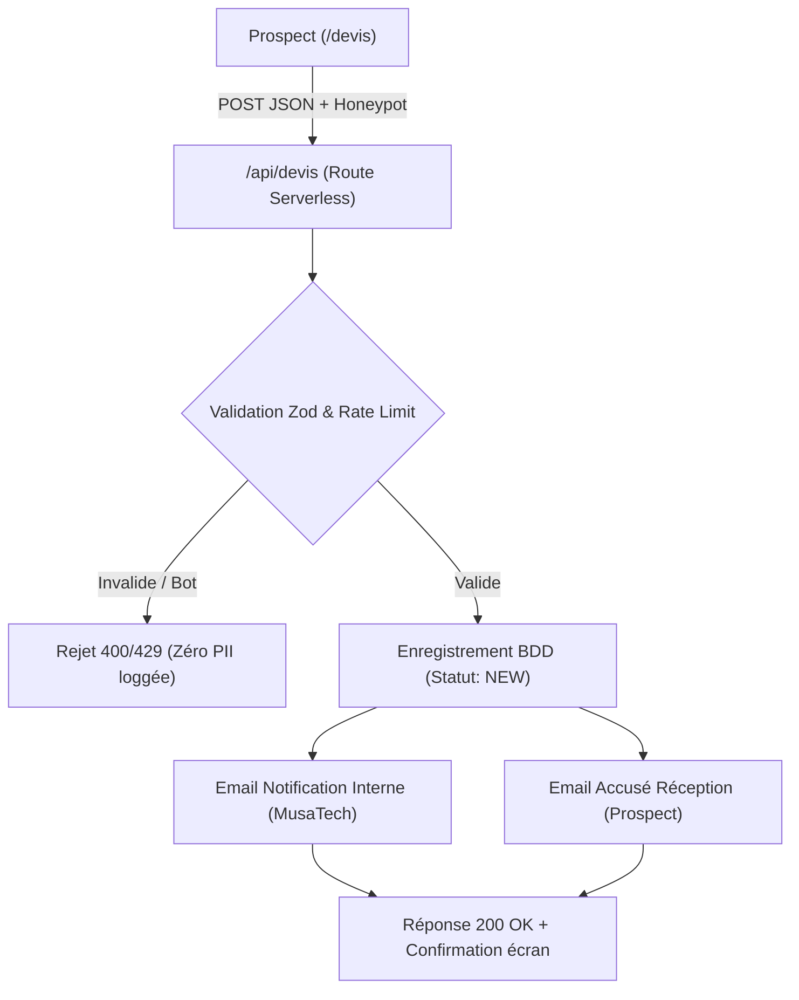

# Guide d'Architecture & Configuration : Traitement des Devis B2B MusaTech

> **Document de référence** pour la mise en production du système de qualification et de traitement des demandes de devis `/devis`.  
> Statut : *Cadrage validé — En attente d'implémentation technique*.

---

## 1. Contexte & Objectif Business

La page `/devis` permet aux prospects B2B (entreprises, directeurs techniques, porteurs de projets au Sénégal et à l'international) de qualifier leur besoin digital (sites web, e-commerce, plateformes métier, applications mobiles).

### Objectifs clés :
1. **Réception et validation côté serveur** des demandes avec contrôle d'intégrité strict.
2. **Protection proactive** contre le spam (honeypot) et les abus (limitation de débit).
3. **Persistance fiable** du prospect et de son besoin avec un cycle de vie en 6 statuts commerciaux.
4. **Notification immédiate** de Moussa Diagne (MusaTech) avec boutons d'action rapide.
5. **Confirmation automatique et rassurante** adressée au prospect sous 24 à 48h ouvrées.
6. **Confidentialité absolue** (RGPD, aucun log public de données personnelles PII, secrets strictement côté serveur).

---

## 2. Audit de l'existant & Services connectés

* **Stack applicative actuelle** : Single Page Application (SPA) React 19 + Vite 8 + TypeScript, hébergée sur Vercel.
* **Services déjà actifs** :
  * `@vercel/analytics` : télémétrie de visite.
  * `src/schemas/quoteSchema.ts` : schéma Zod complet (10 champs requis/optionnels, devises FCFA/EUR/USD, honeypot).
  * `src/lib/quoteService.ts` : service client intégrant une protection anti-flood locale, une détection honnête de l'état du backend via `isBackendConfigured()`, et un basculement de repli vers WhatsApp et Mailto sans simuler de faux succès.
* **Services absents à ce stade** :
  * Aucune base de données active connectée (aucun client DB dans le code).
  * Aucun service d'envoi d'emails transactionnels relié (aucune clé d'API de messagerie).

---

## 3. Évaluation comparative des 4 options

| Option | Stockage & Traitement | Gestion des Statuts | Complexité / Maintenance | Recommandation MusaTech |
| :--- | :--- | :--- | :--- | :--- |
| **Option 1 : Full Serverless (PostgreSQL via Prisma + Resend)** | Base SQL managée (Supabase ou Neon) + Serverless Function `/api/devis`. | Excellente : table typée, indexée, gestion native des 6 statuts. | Faible à modérée : ORM standardisé, migrations sécurisées. | **Fortement Recommandée** : pérenne, robuste et évolutive. |
| **Option 2 : Transactionnel pur (Resend seul)** | L'email reçu dans l'inbox fait office de lead. | Faible : pas de persistance en base sans outil externe. | Minimale. | Insuffisant pour un suivi rigoureux des opportunités d'affaires. |
| **Option 3 : Suivi léger (Google Sheets / Notion via Webhook)** | Envoi vers tableur ou base Notion via webhook sécurisé. | Bonne, mais dépendance envers un tiers externe no-code. | Faible, mais fragile aux changements d'API / tokens tiers. | Alternative acceptable si refus d'héberger une base SQL. |
| **Option 4 : CRM Externe (HubSpot, Brevo CRM)** | Enregistrement de contact / deal via API CRM. | Complète, mais interface lourde et surdimensionnée. | Élevée : configuration de pipelines et de tokens OAuth. | Déconseillée pour une activité freelance solo. |

---

## 4. Architecture cible retenue (Option 1)



---

## 5. Modèle de Données & Cycle de Vie du Prospect

### 5.1. Les 6 Statuts Commerciaux
Chaque demande de devis suit un cycle de vie clair :
1. `NEW` : Demande reçue, en attente de première revue par Moussa Diagne.
2. `CONTACTED` : Premier contact établi avec le prospect (email ou appel).
3. `MEETING` : Rendez-vous de cadrage ou démonstration planifié / réalisé.
4. `PROPOSAL_SENT` : Proposition commerciale et devis chiffré transmis.
5. `WON` : Projet signé et validé (acompte versé ou contrat conclu).
6. `LOST` : Projet non concrétisé (hors budget, reporté ou sans suite).

### 5.2. Définition TypeScript (`QuoteLead`)
```typescript
export type LeadStatus =
  | 'NEW'
  | 'CONTACTED'
  | 'MEETING'
  | 'PROPOSAL_SENT'
  | 'WON'
  | 'LOST';

export interface QuoteLead {
  id: string;                     // Identifiant unique (UUID ou CUID)
  name: string;                   // Nom complet du contact
  email: string;                  // Email professionnel vérifié
  company?: string | null;        // Raison sociale de l'entreprise
  phone?: string | null;          // Numéro Téléphone / WhatsApp
  country: string;                // Pays de résidence ou d'opération
  serviceRequested: string;       // Prestation demandée (ex: sites-web, plateformes-metier)
  budget: string;                 // Fourchette budgétaire
  description: string;            // Description détaillée du besoin
  status: LeadStatus;             // Statut courant (défaut : NEW)
  createdAt: Date;                // Horodatage de création
  updatedAt: Date;                // Horodatage de dernière mise à jour
}
```

### 5.3. Schéma Prisma Cible (`prisma/schema.prisma`)
```prisma
datasource db {
  provider = "postgresql"
  url      = env("DATABASE_URL")
}

generator client {
  provider = "prisma-client-js"
}

enum LeadStatus {
  NEW
  CONTACTED
  MEETING
  PROPOSAL_SENT
  WON
  LOST
}

model QuoteLead {
  id               String     @id @default(cuid())
  name             String
  email            String
  company          String?
  phone            String?
  country          String
  serviceRequested String
  budget           String
  description      String     @db.Text
  status           LeadStatus @default(NEW)
  createdAt        DateTime   @default(now())
  updatedAt        DateTime   @updatedAt

  @@index([status])
  @@index([createdAt])
}
```

---

## 6. Spécification des Templates d'Email

### 6.1. Template Interne : Notification MusaTech
* **Expéditeur** : `MusaTech Système <notifications@musatech.tech>`
* **Destinataire** : `musadev27@gmail.com`
* **Objet** : `[Nouveau Devis] {{serviceRequested}} — {{name}} ({{country}})`
* **Structure du contenu** :
  * En-tête sobre : Logo MusaTech & mention "Nouvelle opportunité commerciale reçue".
  * Tableau récapitulatif :
    * **Nom complet** : `{{name}}`
    * **Société** : `{{company}}` *(ou "Non renseignée")*
    * **Email** : `{{email}}`
    * **Téléphone / WhatsApp** : `{{phone}}` *(avec lien direct `wa.me` si disponible)*
    * **Pays** : `{{country}}`
    * **Prestation** : `{{serviceRequested}}`
    * **Budget estimé** : `{{budget}}`
    * **Statut initial** : `NEW`
  * Bloc de texte : Description complète du besoin rédigée par le prospect.
  * Boutons d'action rapide :
    * Bouton primaire : "Répondre par email" (`mailto:{{email}}`)
    * Bouton secondaire : "Ouvrir sur WhatsApp" (`https://wa.me/{{phoneRaw}}`)

### 6.2. Template Prospect : Accusé de réception
* **Expéditeur** : `Moussa Diagne | MusaTech <contact@musatech.tech>`
* **Destinataire** : `{{email}}` du prospect
* **Objet** : `Confirmation de votre demande de devis — MusaTech`
* **Structure du contenu** :
  * Message personnalisé et chaleureux :
    > "Bonjour {{name}},\n\nJ'ai bien reçu votre demande de devis concernant votre projet de {{serviceRequested}} pour {{company}}.\n\nJ'analyse actuellement les éléments techniques et fonctionnels de votre besoin et je reviendrai vers vous avec un premier retour ou une proposition d'échange sous 24 à 48 heures ouvrées.\n\nSi vous avez des documents complémentaires (cahier des charges, maquettes), vous pouvez simplement répondre à cet email ou me contacter directement sur WhatsApp au +221 78 010 54 26.\n\nBien cordialement,\nMoussa Diagne\nFondateur MusaTech — Développeur Full Stack"

---

## 7. Sécurité & Confidentialité

1. **Re-validation serveur** : L'API ne fait jamais confiance aux données envoyées par le navigateur. Tout payload est passé au schéma Zod strict.
2. **Honeypot invisible** : Champ caché `honeypot`. Si un bot remplit ce champ, la requête est rejetée immédiatement sans notification d'erreur révélatrice.
3. **Limitation de débit (Rate Limiting)** : Fenêtre glissante de 15 minutes autorisant au maximum 3 soumissions par adresse IP.
4. **Zéro fuite PII dans les logs** :
   * Les logs applicatifs (Vercel ou console) enregistrent uniquement : `{ timestamp, projectType, country, hasCompany: boolean, status: 'SUCCESS' | 'ERROR' }`.
   * Le nom, l'email, le téléphone et la description ne sont **jamais** écrits dans les logs d'exécution.
5. **Secrets étanches** :
   * Aucune variable contenant une clé privée ne porte le préfixe `VITE_`.
   * Les secrets restent cantonnés à l'environnement d'exécution de la Serverless Function.

---

## 8. Variables d'Environnement (Noms seuls)

Pour connecter le service en production, voici les variables à configurer dans le tableau de bord Vercel :

```bash
# Base de données PostgreSQL (Supabase / Neon)
DATABASE_URL=

# Envoi d'emails transactionnels (Resend)
RESEND_API_KEY=
EMAIL_FROM=
NOTIFICATION_EMAIL_TO=

# Optionnel : Rate limiting distribué (Upstash Redis)
UPSTASH_REDIS_REST_URL=
UPSTASH_REDIS_REST_TOKEN=
```

---

## 9. Instructions de Configuration Manuelle (Pas à Pas)

### Étape 1 : Base de données (Supabase ou Neon)
1. Créer un projet gratuit sur [Supabase](https://supabase.com) ou [Neon](https://neon.tech).
2. Récupérer l'URL de connexion PostgreSQL sécurisée (avec pooler de connexions en mode Serverless).
3. Renseigner cette URL dans la variable `DATABASE_URL`.
4. Exécuter la migration Prisma initiale : `npx prisma db push`.

### Étape 2 : Service d'Email (Resend)
1. Créer un compte sur [Resend](https://resend.com).
2. Ajouter le domaine `musatech.tech` et configurer les enregistrements DNS requis (DKIM, SPF, MX de retour).
3. Générer une clé API avec les permissions d'envoi.
4. Renseigner la clé dans `RESEND_API_KEY`.
5. Définir `EMAIL_FROM="MusaTech <devis@musatech.tech>"` et `NOTIFICATION_EMAIL_TO="musadev27@gmail.com"`.

### Étape 3 : Déploiement Vercel
1. Dans le projet Vercel MusaTech, ouvrir **Settings > Environment Variables**.
2. Ajouter les 4 variables sans guillemets superflus.
3. Lancer un redéploiement pour charger les nouvelles variables serveur.

---

## 10. Prochaines Étapes de Développement

Lorsque nous reprendrons ce chantier :
* [ ] Implémenter le fichier de schéma Prisma `prisma/schema.prisma`.
* [ ] Créer l'endpoint Serverless `api/devis.ts` (ou Route Handler).
* [ ] Coder les générateurs d'emails HTML/Texte dans `src/lib/emailTemplates.ts`.
* [ ] Mettre à jour `src/lib/quoteService.ts` pour appeler `/api/devis`.
* [ ] Écrire les tests Vitest unitaires et d'intégration avec mocks d'envoi (aucun prospect réel contacté en test).

