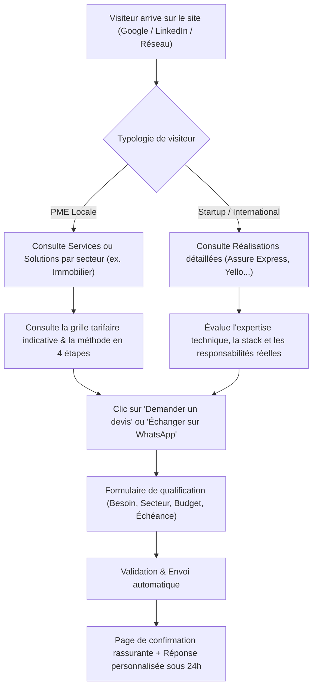

# CAHIER DES CHARGES FONCTIONNEL & TECHNIQUE (REQUIREMENTS) — MUSATECH

> **Projet** : MusaTech ([https://www.musatech.tech/](https://www.musatech.tech/))  
> **Auteur / Intervenant** : Senior Software Engineer & Architecte  
> **Documents de référence** : `docs/MUSATECH_MASTER_SPEC.md` & `docs/AUDIT.md`  
> **Statut** : Document de spécification — Aucune implémentation de code applicatif à ce stade.

---

## 1. Objectifs business

1. **Génération de prospects B2B qualifiés** : Transformer le portfolio personnel existant en une plateforme commerciale crédible et persuasive, incitant les décideurs d'entreprises (PME, directeurs généraux, directeurs d'agences) et fondateurs de startups à demander un devis ou initier un échange.
2. **Clarification du positionnement de marque** :
   - Présenter MusaTech non pas comme une agence tentaculaire impersonnelle, mais comme un **partenaire d'ingénierie logicielle agile**, incarné et piloté par son fondateur **Moussa Diagne**.
   - Garantir une relation de confiance directe, sans intermédiaire commercial dilutif.
   - Promesse forte : *"Des solutions digitales qui font avancer votre entreprise."*
3. **Double marché géographique** :
   - **Sénégal / UEMOA** : Proposer des solutions adaptées aux réalités locales (tarification en FCFA, intégration des problématiques locales, WhatsApp, réassurance de proximité).
   - **International (Europe, Amérique du Nord, Afrique anglophone)** : Offrir des services d'ingénierie logicielle de haut niveau (Next.js, NestJS, React Native, TypeScript, cloud) pour du renfort technique, du développement de produits SaaS et d'applications sur-mesure.
4. **Visibilité et référencement naturel (SEO B2B)** : Se positionner durablement sur les requêtes ciblées de recherche de prestataires à Dakar et à l'international (ex. "développement logiciel Dakar", "création application mobile Sénégal", "développeur Next.js React Native freelance expert").

---

## 2. Personas & Clients cibles

### 2.1. Cible locale (Sénégal)

#### Persona 1 : Amadou — Gérant de PME / Agence Immobilière (Dakar)
- **Profil** : 42 ans, dirigeant d'une agence immobilière ou société de services en pleine expansion.
- **Problématique** : Utilise des outils dispersés (WhatsApp, Excel) ou un site vitrine vieillissant. Perd des clients faute de réactivité et d'un catalogue en ligne fiable.
- **Besoins** : Un site professionnel moderne, un catalogue interactif, une prise de contact fluide via WhatsApp/formulaire, un interlocuteur joignable et fiable à Dakar.
- **Sensibilité** : Clarté des prix, respect des délais, réassurance locale.

#### Persona 2 : Fatou — Directrice d'école privée ou centre de formation
- **Profil** : 38 ans, responsable pédagogique et administrative.
- **Problématique** : Gestion manuelle des inscriptions, des plannings et du suivi des élèves chronophage.
- **Besoins** : Plateforme web sur-mesure ou portail de gestion adapté aux spécificités locales, paiement mobile sécurisé.
- **Sensibilité** : Ergonomie, facilité de prise en main pour le personnel.

### 2.2. Cible internationale

#### Persona 3 : Julien — CTO / Head of Product d'une Startup (Paris / Bruxelles)
- **Profil** : 34 ans, responsable technique d'une jeune pousse en accélération.
- **Problématique** : Équipe tech saturée, besoin immédiat de renfort senior autonome sur la stack Next.js 15 / NestJS / React Native.
- **Besoins** : Développeur rigoureux, architecture modulaire, respect des standards (tests Jest/Vitest, TypeScript strict, API Swagger, CI/CD).
- **Sensibilité** : Qualité du code, autonomie, sérieux des réalisations passées.

#### Persona 4 : Sarah — Directrice d'une agence digitale (Montréal / Londres)
- **Profil** : 40 ans, cherche des partenaires techniques externes de confiance pour déléguer la production d'applications mobiles ou de dashboards complexes.
- **Besoins** : Vélocité, transparence, respect strict des maquettes et des délais contractuels.

---

## 3. Parcours utilisateurs (User Journeys) & Entonnoirs de conversion



### Étapes clés de conversion :
1. **Accroche** : Hero commercial exposant immédiatement la promesse et le profil expert.
2. **Identification** : Bloc "Problèmes que nous résolvons" segmenté par typologie d'entreprise.
3. **Preuve par l'exemple** : Réalisations réelles chiffrées avec rôle explicite de Moussa Diagne.
4. **Réassurance** : Transparence tarifaire indicative (sans mauvaise surprise) et méthodologie en 4 phases.
5. **Action** : Formulaire de devis guidé en 3 étapes ou contact direct WhatsApp/Téléphone pour les urgences.

---

## 4. Arborescence du site

```text
/ (Accueil)
├── /services (Vue d'ensemble des offres)
│   ├── /services/sites-web (Sites web professionnels)
│   ├── /services/e-commerce (Boutiques en ligne & paiement local)
│   ├── /services/logiciels-metier (Plateformes & ERP/CRM sur-mesure)
│   └── /services/applications-mobiles (Applications iOS & Android React Native)
├── /solutions (Solutions par secteur d'activité)
│   ├── /solutions/immobilier (Agences & promoteurs)
│   ├── /solutions/education (Écoles, universités & EdTech)
│   ├── /solutions/commerce (Boutiques, distribution & grossistes)
│   └── /solutions/logistique (Transport, fret & suivi opérationnel)
├── /realisations (Galerie des projets)
│   ├── /realisations/assure-express (InsurTech & App Mobile)
│   ├── /realisations/yello (EdTech IA 200k apprenants)
│   ├── /realisations/istamco (CRM Logistique Freight Forwarding)
│   ├── /realisations/sapiow (Marketplace Services & Géolocalisation)
│   └── /realisations/edaktarii (HealthTech & Téléconsultation)
├── /a-propos (MusaTech, la vision et le fondateur Moussa Diagne)
├── /contact (Coordonnées directes, bureau Dakar, réseaux)
├── /devis (Tunnel de demande de devis qualifié)
├── /politique-confidentialite (Conformité des données)
└── /mentions-legales (Informations légales)

*Note : La version anglaise reproduit l'ensemble sous le préfixe /en/...*
```

---

## 5. Spécifications détaillées des pages et sections

### 5.1. Page d'accueil (`/`)
1. **Header / Navigation** :
   - Logo MusaTech avec typographie Manrope.
   - Menu desktop : Services (déroulant ou direct), Solutions, Réalisations, À propos, Contact.
   - Sélecteur de langue interactif FR / EN.
   - Bouton CTA principal : `Demander un devis`.
2. **Hero commercial** :
   - Titre fort (H1) orienté bénéfice : ex. *"Concevez des logiciels, sites et applications qui accélèrent votre croissance."*
   - Sous-titre rassurant mentionnant l'expertise et la localisation (Dakar & International).
   - Double CTA : `Estimer mon projet` (vers `/devis`) et `Découvrir nos réalisations` (vers `/realisations`).
   - Badges de réassurance : Expérience senior, projets déployés, technologies modernes.
3. **Section "Problèmes résolus"** :
   - 3 cartes comparatives : Processus manuels chronophages, sites non optimisés qui ne convertissent pas, dette technique bloquante.
4. **Section "Services phares"** :
   - 4 cartes d'offres majeures avec tarif d'appel indicatif et lien vers la page détaillée.
5. **Section "Solutions par secteur"** :
   - Onglets interactifs ou cartes : Immobilier, Éducation, Commerce, Logistique.
6. **Section "Réalisations sélectionnées"** :
   - Présentation de 3 projets phares (Yello, Assure Express, Istamco) avec métriques clés, technologies et bouton d'accès au cas complet.
7. **Section "Méthode de travail" (4 étapes)** :
   - 01. Cadrage & Spécifications -> 02. Conception & UI/UX -> 03. Développement & Tests -> 04. Déploiement & Suivi.
8. **Section "Le Fondateur & MusaTech"** :
   - Photo professionnelle sobre, présentation de Moussa Diagne, vision artisanale et haut de gamme du développement logiciel.
9. **FAQ commerciale** :
   - 5 questions fréquentes (Délais moyens, modalités de paiement, maintenance après livraison, propriété du code source).
10. **CTA Final (Bannière contrastée Navy/Cyan)** :
    - Titre incitatif : *"Un projet digital en vue ? Obtenez une estimation claire sous 24h."*
11. **Footer** :
    - Coordonnées, liens légaux, copyright, signature "Conçu & développé à Dakar 🇸🇳".

### 5.2. Pages Services (`/services/...`)
- Structure type d'une page service :
  - **Hero dédié** : Définition de l'offre et à qui elle s'adresse.
  - **Fonctionnalités incluses** : Liste précise des livrables (responsive, SEO, sécurité, panneau d'administration, etc.).
  - **Fourchette tarifaire indicative** : Rappel du tarif d'appel configurable (ex. *À partir de 250 000 FCFA*).
  - **Étude de cas liée** : Projet en rapport direct avec le service.
  - **Formulaire contextuel / CTA devis**.

### 5.3. Pages Solutions sectorielles (`/solutions/...`)
- Focus sur les problématiques métier d'un secteur précis (ex. agences immobilières dakaroises).
- Fonctionnalités indispensables recommandées pour ce secteur.
- Exemple d'architecture technique adaptée.

### 5.4. Pages Réalisations (`/realisations` et `[slug]`)
- **Fiche projet standardisée** :
  - Titre du projet et client / contexte.
  - Métriques d'impact réelles (ex. 200 000 apprenants, architecture multi-pays).
  - Défi technique initial.
  - Solution apportée par MusaTech.
  - Rôle précis et documenté de Moussa Diagne (Architecture, Lead dev, etc.).
  - Stack technique détaillée avec tags.
  - Lien externe vers le projet ou dépôt GitHub si public.

### 5.5. Page Demande de devis (`/devis`)
- Formulaire structuré en 3 étapes :
  - **Étape 1 : Le projet** (Type de besoin : Site web, E-commerce, Logiciel métier, App mobile, Autre).
  - **Étape 2 : Le contexte** (Secteur d'activité, budget estimatif en FCFA ou EUR/USD, délai souhaité).
  - **Étape 3 : Vos coordonnées** (Nom, Entreprise, Email professionnel, Numéro WhatsApp/Téléphone, Description synthétique).
- Sécurisation contre le spam (Honeypot + validation d'email).

---

## 6. Exigences non fonctionnelles

### 6.1. Exigences SEO (Search Engine Optimization)
- Rendu côté serveur (SSR) ou génération statique (SSG) de toutes les pages éditoriales.
- Balises `<title>` et `<meta name="description">` personnalisées et uniques pour chaque URL.
- Balisage Open Graph (`og:image`, `og:title`, etc.) et Twitter Cards optimisés pour le partage social.
- Balisage Schema.org en JSON-LD :
  - `ProfessionalService` sur la page d'accueil avec localisation à Dakar et marchés couverts.
  - `BreadcrumbList` sur les pages imbriquées (Services, Réalisations).
- Fichiers `sitemap.xml` et `robots.txt` générés dynamiquement.
- Gestion bilingue avec balises `<link rel="alternate" hreflang="fr" href="...">` et `hreflang="en"`.

### 6.2. Exigences d'accessibilité (WCAG 2.1 AA)
- Ratios de contraste conformes aux normes WCAG AA : minimum 4.5:1 pour le texte normal, 3:1 pour le texte large et les éléments d'interface.
- Navigation 100% au clavier possible (styles `:focus-visible` distincts avec outline Cyan `#19B8CD`).
- Attributs ARIA obligatoires sur tous les composants interactifs (modales, menus accordéons, menus déroulants).
- Prise en compte absolue du réglage système `@media (prefers-reduced-motion: reduce)` pour désactiver les transitions et animations de déplacement.

### 6.3. Exigences de performance (Core Web Vitals)
- Objectifs Lighthouse :
  - **Performance** ≥ 90 / 100.
  - **Accessibilité** = 100 / 100.
  - **Best Practices** = 100 / 100.
  - **SEO** = 100 / 100.
- Mesures clés :
  - Largest Contentful Paint (LCP) < 2.5s.
  - Interaction to Next Paint (INP) < 200ms.
  - Cumulative Layout Shift (CLS) < 0.1.
- Optimisation des polices : utilisation de polices locales ou auto-hébergées avec `font-display: swap` sans layout shift.
- Optimisation des images : compression WebP/AVIF, attributs `width`/`height` explicites pour éviter tout sautillement.

### 6.4. Exigences de confidentialité et sécurité
- Pas de cookies traceurs superflus sans consentement préalable.
- Conformité de base à la protection des données personnelles (mention informative sur les formulaires).
- En-têtes HTTP de sécurité (CSP strict, X-Content-Type-Options, Referrer-Policy, HSTS).
- Assainissement (sanitization) et validation stricte de toutes les entrées utilisateurs côté serveur via Zod.
- Aucune donnée secrète ou clé d'API commitée dans le dépôt.

---

## 7. User Stories & Critères d'acceptation

### US-01 : Consultation des services et tarifs d'appel
- **En tant que** gérant de PME dakaroise,
- **Je veux** consulter les différents types de services et leurs tarifs indicatifs en FCFA,
- **Afin de** savoir immédiatement si MusaTech correspond à mes capacités budgétaires avant de m'engager.
- **Critères d'acceptation** :
  - Les 4 services majeurs sont clairement distincts avec leur prix "À partir de".
  - Une mention explicite indique que les tarifs sont indicatifs et personnalisables sur devis.
  - Un clic sur un service mène à une page détaillée expliquant la valeur concrète apportée.

### US-02 : Soumission d'une demande de devis
- **En tant que** directeur d'entreprise ayant un projet,
- **Je veux** remplir un formulaire simple précisant mon secteur, mon type de besoin et mon budget estimatif,
- **Afin d'** obtenir une proposition commerciale personnalisée sous 24 à 48 heures.
- **Critères d'acceptation** :
  - Le formulaire valide les champs obligatoires (email valide, numéro de téléphone, sélection de service).
  - Un message d'erreur clair s'affiche si un champ est invalide.
  - À la soumission, l'utilisateur voit un écran de confirmation rassurant.
  - Une notification email est déclenchée vers Moussa Diagne avec l'ensemble des détails qualifiés.

### US-03 : Évaluation de la crédibilité technique
- **En tant que** CTO de startup internationale cherchant un renfort senior,
- **Je veux** analyser les études de cas réelles (architecture, rôle exact, technologies),
- **Afin de** m'assurer de la rigueur et du niveau technique de l'interlocuteur.
- **Critères d'acceptation** :
  - Les réalisations mentionnent clairement le rôle de Moussa Diagne (pas de revendication abusive).
  - La stack technique est détaillée (ex. NestJS, PostgreSQL, React Native, Next.js).
  - Des liens vérifiables (sites ou dépôts GitHub publics) sont fournis quand ils existent.

---

## 8. Décisions nécessitant validation formelle

1. **Grille tarifaire publique** : Validation finale des montants indicatifs (250 000 FCFA pour site web, 600 000 FCFA pour e-commerce, 1 500 000 FCFA pour logiciel métier, 2 000 000 FCFA pour application mobile).
2. **Fournisseur de messagerie transactionnelle** : Choix du service d'envoi pour les notifications de devis (Resend, Brevo, ou SendGrid).
3. **Numéro de contact professionnel** : Validation du numéro officiel affiché pour les échanges WhatsApp / Téléphone (+221 78 010 54 26).
4. **Hébergement des images de réalisations** : Validation des visuels ou captures d'écran autorisés pour chaque projet client.

